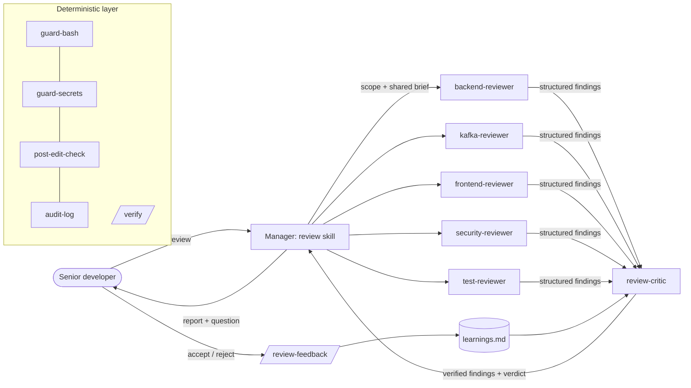

# Agentic Review Kit — Spring Boot 3 / Java 17 / Kafka + React

A local multiagent code-verification system for Claude Code, made to support a senior developer
on a **Spring Boot 3 (Java 17, Maven) + Apache Kafka + React** project. Its design follows
*Building Applications with AI Agents: Designing and Implementing Multiagent Systems*
(Michael Albada, O'Reilly, 2025).

> Java 17 guard: if your local JDK is newer (e.g. 21), code using Java 21 APIs (virtual threads,
> `getFirst()` on lists, type patterns in `switch`) compiles in the IDE but fails with `--release 17`.
> The `post-edit-check` hook catches this as soon as the file is written.

## Install

Copy into the root of your repository:
```
CLAUDE.md            → merge with your existing CLAUDE.md if you have one
.claude/             → agents, skills, rules, hooks, settings
```
Requirements: Node 18+ (already needed for React), git, and Docker for Testcontainers-based Kafka
integration tests. Nothing to install, and the hooks have no dependencies.

Open Claude Code in the repo. The session-start hook prints the detected stack. Then:

| Command | What happens |
|---------|--------------|
| `/review` | Multiagent review of uncommitted changes (or `/review main` for the branch, `/review path/A.java`) |
| `/review --quick` | Specialists only, no critic pass (faster, unverified) |
| `/verify [backend\|frontend] [--fast]` | Deterministic build + lint + test |
| `/review-feedback BE-1 accepted, SEC-2 false positive: …` | Teaches the system from your verdicts |
| `/review-eval` | Benchmarks the reviewers on seeded-bug fixtures (run after changing prompts/rules) |
| `/new-endpoint GET /api/x/{id} …` | Scaffolds controller/service/DTO/tests to team standards |
| `/new-kafka-listener consumer\|producer …` | Scaffolds an idempotent listener with DLT, or an outbox/after-commit producer, plus Testcontainers tests |
| `/react-component Name purpose` | Scaffolds component + hook + RTL tests |

## Architecture



```
.claude/
├── settings.json              permissions (allow/ask/deny) + hook wiring
├── agents/                    specialists (read-only tools) + critic
├── skills/
│   ├── review/                manager / orchestrator
│   ├── verify/scripts/        deterministic pipeline (verify.mjs)
│   ├── review-feedback/       improvement loop
│   ├── review-eval/           fixtures + expected.json + results.md
│   ├── new-endpoint/          scaffolding (REST)
│   ├── new-kafka-listener/    scaffolding (Kafka consumer / producer)
│   └── react-component/       scaffolding
├── rules/                     path-scoped standards (java-spring, kafka, react, testing) + always-on (security, autonomy)
├── hooks/                     Node scripts, no dependencies
└── review-memory/learnings.md curated long-term memory
```

## How the book's ideas are applied

| Book concept | Where it lives |
|--------------|----------------|
| Choose agents only for open-ended work; use deterministic workflows for fixed steps (ch. 1) | `/verify` is a script, not an agent; hooks do the checks a regex or compiler can do |
| Task decomposition and **specialisation** (ch. 8, "Principles for Adding Agents") | 5 specialists with separate concerns and separate finding-id prefixes (`BE`, `KFK`, `FE`, `SEC`, `TST`) |
| **Parsimony**: only add agents that bring clear value (ch. 8) | Routing table in `/review` starts only the agents the change needs; no agent for docs-only changes. `kafka-reviewer` exists because messaging failures (lost or duplicate messages, poison pills, dual writes) are a separate failure area that a general backend prompt tends to miss. It only runs when Kafka code or config changes |
| **Manager coordination** (ch. 8) | The `/review` skill decomposes, routes, and merges results. Subagents never talk to each other |
| **Actor-critic** quality gate (ch. 8) | `review-critic` re-checks each finding against the code, drops false positives, and adjusts severity. One extra pass at most |
| Coordination protocol / communication (ch. 8) | Every agent returns the same structured format: `id · severity · confidence · location · evidence · problem · fix` |
| Parallel tool topology (ch. 5) | Specialists start in a single message and run at the same time |
| **Context engineering** (ch. 5) | Agents get a compact shared brief (versions, file list, relevant lessons), not the full diff. Rules load by path. The session-start hook adds the current stack and git state |
| Memory + non-parametric learning (ch. 6–7) | `review-memory/learnings.md`, curated by `/review-feedback` and read by the critic |
| Improvement loops (ch. 11) | Developer verdicts → lessons → fewer false positives in later reviews |
| Validation & measurement (ch. 9) | `/review-eval`: recall, blocker recall, precision, and severity accuracy on fixtures, tracked in `results.md` |
| Safeguards: role/permission management, behaviour constraints (ch. 12) | Reviewers only have `Read, Grep, Glob`. `settings.json` has allow, ask, and deny lists. Guard hooks block destructive commands and secrets, and block the call if they cannot read their input |
| Audit trails (ch. 12) | `audit-log.mjs` records which tool ran, when, and on which file in `.claude/logs/audit.jsonl`. It redacts secrets and never logs file contents |
| Input validation / prompt-injection awareness (ch. 12) | The security reviewer treats code as data and reports instructions hidden in it |
| Human roles & progressive delegation (ch. 13) | `rules/agent-autonomy.md`: act / propose / ask / never levels. `/review` ends by asking which fixes to apply |
| Resilience (ch. 1 principles) | Failed specialist → one retry, then reported as a coverage gap. A deterministic check outranks an LLM opinion |

## Hooks reference

| Hook | Event | Behaviour |
|------|-------|-----------|
| `session-context.mjs` | SessionStart | Adds Spring Boot/Java/React versions, git branch, changed files, and the number of saved lessons to the context |
| `guard-bash.mjs` | PreToolUse Bash/PowerShell | Blocks `rm -rf`, force push, `reset --hard`, `--no-verify`, `curl \| sh`, deploy/publish, mutating kubectl/terraform/cloud commands, Kafka topic deletion/alteration and offset resets, destructive SQL, privilege escalation, and edits to its own guardrails |
| `guard-secrets.mjs` | PreToolUse Write/Edit | Blocks `.env`, keys, keystores, and hard-coded credentials, and points to Vault / AWS / GCP secrets managers. `.env.example` is allowed |
| `post-edit-check.mjs` | PostToolUse Write/Edit | Java: `jakarta.*` only, Java 21 APIs blocked under `--release 17`, removed Spring Security 5 APIs, SQL concatenation, XXE, deserialization, CORS `*`, upload/SSRF warnings, hygiene. Kafka code: trusted packages `*`, auto-commit, weakened acks/idempotence, ignored send results, missing `groupId`, possible dual writes. `application*.yml/properties`: the same Kafka settings, PLAINTEXT outside local profiles, missing `ErrorHandlingDeserializer`, `ddl-auto`. React: XSS, `eval`, tokens in storage or URLs, `console.log`, `any`, index keys, plus your own ESLint. Manifests: unpinned versions, git-URL dependencies. **Errors go back to Claude to fix; warnings are added as context** |
| `audit-log.mjs` | PostToolUse *, SubagentStop | Append-only JSONL audit trail |

Hook files under `.claude/` are skipped by `post-edit-check`, so the deliberately broken eval fixtures don't trigger it.

## Customising

- **Layout**: if your modules are not in `backend/` and `frontend/`, edit the folder lists in
  `verify.mjs` and `session-context.mjs`, and the `paths:` globs in `rules/*.md`.
- **Models**: the specialists use `sonnet`; `security-reviewer` and `review-critic` use `opus`.
  Change the `model:` field in `agents/*.md`.
- **Adding an agent**: first check whether an existing agent's prompt or a rule could cover it.
  If you add one, give it a finding-id prefix, read-only tools, the shared output format, and a
  routing entry in `skills/review/SKILL.md`, then run `/review-eval`.
- **Team vs personal**: commit `.claude/` (except `logs/`, `reports/`, `settings.local.json`, see
  `.claude/.gitignore`). Personal overrides go in `.claude/settings.local.json`.
